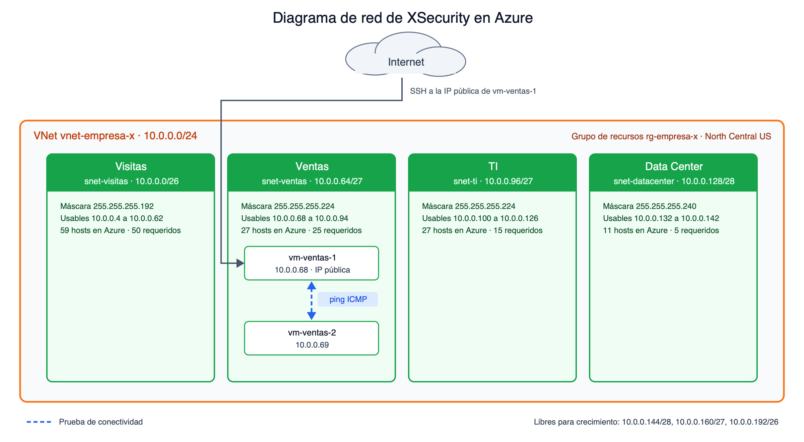

# Diseño y segmentación de la red

Proveedor: Microsoft Azure (suscripción Azure for Students), región `North Central US`.

## Bloque de la red virtual

**La VNet usa `10.0.0.0/24`.** Son 256 direcciones privadas (RFC 1918). Alcanzan para las cuatro subredes y dejan 112 direcciones libres para crecer. Si la empresa crece más, Azure permite agregar otro espacio de direcciones a la VNet sin rehacer las subredes existentes.

## Consideraciones de Azure

**Azure reserva 5 direcciones en cada subred.** Además de la dirección de red y la de broadcast, toma la `.1` para el gateway predeterminado y la `.2` y `.3` para el DNS de Azure. Por eso los hosts usables son el tamaño del bloque menos 5, y no menos 2 como en el subneteo tradicional.

**La subred más pequeña permitida es /29.** Con las reservas, un /29 deja solo 3 hosts usables.

## Método

**Se usó VLSM ordenando de mayor a menor.** Se asigna primero la subred con más hosts y cada una empieza justo después del broadcast de la anterior. Así todos los bloques quedan alineados y no se desperdician huecos entre ellos.

**A cada subred se le dio el bloque más pequeño que alcanza** para sus hosts después de restar las 5 reservas.

| Subred | Hosts | Bloque que alcanza | Bloque menor (no alcanza) | Prefijo |
|---|---|---|---|---|
| Visitas | 50 | 64 menos 5 = 59 | 32 menos 5 = 27 | /26 |
| Ventas | 25 | 32 menos 5 = 27 | 16 menos 5 = 11 | /27 |
| TI | 15 | 32 menos 5 = 27 | 16 menos 5 = 11 | /27 |
| Data Center | 5 | 16 menos 5 = 11 | 8 menos 5 = 3 | /28 |

**Data Center es el caso donde Azure cambia el resultado.** Con subneteo tradicional un /29 da 6 hosts y alcanzaría para 5 servidores. En Azure solo quedan 3 usables, así que hay que subir a /28.

**La red de visitas se dimensionó para 50 hosts.** El enunciado no da el número, así que se supuso esa cantidad para cubrir clientes y proveedores que visitan la oficina al mismo tiempo.

## Tabla de subredes

| Subred | Nombre en Azure | Hosts requeridos | CIDR | Máscara | Red | Broadcast | Rango usable en Azure | Usables en Azure | Usables tradicional | Sobrantes |
|---|---|---|---|---|---|---|---|---|---|---|
| Visitas | snet-visitas | 50 | 10.0.0.0/26 | 255.255.255.192 | 10.0.0.0 | 10.0.0.63 | 10.0.0.4 a 10.0.0.62 | 59 | 62 | 9 |
| Ventas | snet-ventas | 25 | 10.0.0.64/27 | 255.255.255.224 | 10.0.0.64 | 10.0.0.95 | 10.0.0.68 a 10.0.0.94 | 27 | 30 | 2 |
| TI | snet-ti | 15 | 10.0.0.96/27 | 255.255.255.224 | 10.0.0.96 | 10.0.0.127 | 10.0.0.100 a 10.0.0.126 | 27 | 30 | 12 |
| Data Center | snet-datacenter | 5 | 10.0.0.128/28 | 255.255.255.240 | 10.0.0.128 | 10.0.0.143 | 10.0.0.132 a 10.0.0.142 | 11 | 14 | 6 |

**Direcciones reservadas por Azure en cada subred**

| Subred | Red | Gateway | DNS de Azure | DNS de Azure | Broadcast |
|---|---|---|---|---|---|
| Visitas | 10.0.0.0 | 10.0.0.1 | 10.0.0.2 | 10.0.0.3 | 10.0.0.63 |
| Ventas | 10.0.0.64 | 10.0.0.65 | 10.0.0.66 | 10.0.0.67 | 10.0.0.95 |
| TI | 10.0.0.96 | 10.0.0.97 | 10.0.0.98 | 10.0.0.99 | 10.0.0.127 |
| Data Center | 10.0.0.128 | 10.0.0.129 | 10.0.0.130 | 10.0.0.131 | 10.0.0.143 |

## Espacio libre

Se asignaron 144 de las 256 direcciones (56.25 %). Quedan libres tres bloques para futuras subredes:

| Bloque | Direcciones | Usables en Azure |
|---|---|---|
| 10.0.0.144/28 | 16 | 11 |
| 10.0.0.160/27 | 32 | 27 |
| 10.0.0.192/26 | 64 | 59 |

## Ruteo

**Azure enruta entre las subredes de una misma VNet sin configurar nada.** Cada subred recibe una ruta del sistema hacia `10.0.0.0/24`, así que las máquinas se comunican entre sí sin crear tablas de rutas.

El cálculo se puede reproducir con `python3 fase1/subneteo.py`.
